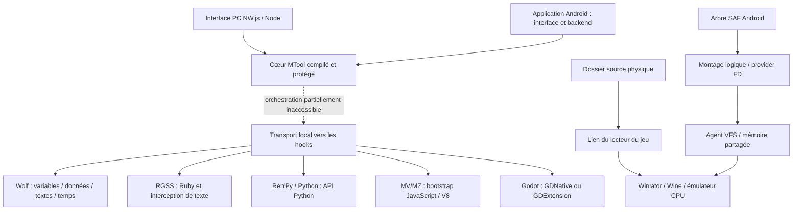

# Analyse REA de MTool pour Astra

Analyse du 12 octobre 2026. Corpus : distribution publique PC `C9344DF0` et cinq APK officiels. Astra comparé au commit `1f3086ea785356a7a3f1e790357948e0745f18d8`, version `1.12.0-beta.22` / code 50.

Les intégrations les plus utiles sont **un accès aux données Wolf par identifiant**, **un accès aux dossiers SAF sans import complet**, puis **des profils de runtime et des diagnostics de performance par jeu**. Les hooks Wolf, le Java des APK et l’agent VFS apportent des preuves techniques de ces mécanismes. Les personnalisations de touches sont déjà largement présentes dans Astra.

Il s’agit d’une analyse statique étendue des paquets téléchargés et du code actuel d’Astra. Aucun jeu ni APK MTool n’a été exécuté pendant cette étude ; aucun changement de moteur, de cheat ou de performance n’a été implémenté dans l’application. Le cœur MTool livré en bytecode protégé reste partiellement inaccessible : ce rapport ne prétend pas avoir récupéré toutes ses fonctions ni démontré une compatibilité universelle.

## Corpus téléchargé et conservé

Les liens proviennent de la [distribution officielle](https://trs.mtool.app/release.php?lang=en), lue au moment du téléchargement. La page HTML et les en-têtes HTTP sont conservés. L’identifiant PC de cette lecture est `C9344DF0` ; un résultat web mis en cache affichait un identifiant plus ancien et n’a pas servi à choisir le paquet.

| Paquet | Fichier original | Taille en octets | Entrées ZIP |
|---|---|---:|---:|
| PC | `MTool_C9344DF0.zip` | 158 247 519 | 1 276 |
| Android principal | `mtool_v55_20.apk` | 247 090 719 | 2 080 |
| RPG Maker XP/VX/VX Ace | `mtool_mkxpz_v64_1.apk` | 397 632 003 | 2 663 |
| RPG Maker 2000/2003 | `mtool_easyrpg_v10000_1.apk` | 172 219 209 | 3 255 |
| Ren’Py | `mtool_renpy_v59_1.apk` | 352 118 845 | 1 046 |
| Winlator | `winlator_v3.1.69_1.apk` | 1 155 377 366 | 1 323 |

Total : **2 482 685 661 octets**, soit environ 2,48 Go, et **11 643 entrées**. Les six archives originales sont intactes dans [downloads](../../build/mtool-research/2026-10-12/downloads). Chaque membre externe a été lu jusqu’à sa fin par `zipfile`, avec son contrôle CRC ; les chemins d’extraction ont été vérifiés. Les SHA-256 locaux figent ce corpus, sans remplacer une signature ou un digest publié par l’éditeur.

Les ressources des APK comportent des chemins distincts uniquement par la casse. REA refuse leur inventaire d’archive pour cette raison. Les APK originaux ont donc été utilisés directement avec JADX ; les membres en collision ont été conservés séparément avec leur index ZIP et leur hash. L’arbre extrait sur Windows n’est pas considéré comme une reproduction exacte de ces ressources. [Provenance](../../build/mtool-research/2026-10-12/evidence/download-provenance.json), [collisions](../../build/mtool-research/2026-10-12/evidence/case-collision-coverage.json).

## Méthode et couverture

REA 6.3.0 a été utilisé réellement, avec Ghidra 12.1.4, le bridge JADX headless et l’analyse JavaScript. Le catalogue courant comporte 139 outils. L’exécution s’est faite dans le conteneur WSL/Docker REA : sources montées en lecture seule, utilisateur non privilégié, racine en lecture seule, réseau désactivé et sans socket Docker. Les exports de preuves ont été enregistrés avant fermeture des sessions natives. [État de l’environnement](../../build/mtool-research/2026-10-12/environment/README.md).

Le graphe Astra existant a été interrogé, puis ses points d’entrée ont été vérifiés dans les sources actuelles. Les fichiers globaux du graphe n’ont pas été reconstruits. [Baseline Astra](../../build/mtool-research/2026-10-12/astra-baseline.md).

| Surface | Travail effectué | Limite de la preuve |
|---|---|---|
| Distribution | Six téléchargements, hashes, inventaires et lecture des membres | Pas de vérification de signature auprès de l’éditeur |
| PC / interface | Manifestes, bootstrap NW.js, ressources et deux analyses JavaScript REA | Logique principale compilée/protégée |
| Wolf | Deux DLL : inventaire, chaînes, références, dispatchers et fonctions de lecture/écriture, sauvegarde, vitesse et garde de version | Pas d’injection ou de test dans un jeu |
| Autres moteurs PC | RGSS, Python64, MZ, loader Godot, Godot 3.0 et 4.2 : fonctions ciblées décompilées | Scripts de logique métier et autres variantes non entièrement récupérés |
| Android | Cinq manifestes et inventaires complets de noms de classes ; classes et méthodes ciblées | Inventorier un nom ne signifie pas décompiler ni tester toute sa classe |
| Stockage Android | Méthodes SAF/FD/SHM et agent ELF de l’APK Winlator | Latence, consommation et comportement de chaque fournisseur SAF non mesurés |
| Runtimes / ressources / licences | Paquets, interfaces natives, dépendances, notices, indices et configurations | Les blobs protégés et archives imbriquées n’ont pas tous été exécutés ou décompilés |
| Performance | Comparaison des réglages et mécanismes observés | Aucun benchmark de FPS, thermique ou chargement sur téléphone |
| Services en ligne | Pages publiques et interfaces visibles | Aucun appel aux services payants, aucune session utilisateur |

Les observations Android comprennent 117 résultats : 5 packages, 5 inventaires totalisant **27 434 noms de classes**, 25 classes ciblées, 77 méthodes et 5 recherches de références. **75 corps de méthode sont disponibles et 2 restent indisponibles**. Le rapport Android les distingue explicitement. [Analyse Android](../../build/mtool-research/2026-10-12/evidence/android-analysis.md), [hooks de moteurs](../../build/mtool-research/2026-10-12/evidence/engine-hooks-analysis.md), [ressources et licences](../../build/mtool-research/2026-10-12/evidence/resources-and-licenses.md).

Les mentions « observé » ci-dessous désignent des octets, des métadonnées ou du code décompilé. « À intégrer » désigne une proposition pour Astra ; son fonctionnement doit encore être implémenté et validé.

## Architecture observée



Le PC repose sur NW.js 0.67.2. `package.json` démarre `www/index.html` et `loader.js` charge un binaire compilé avec `evalNWBin`, ou une variante destinée au backend Gecko Android. Le fichier `loader.bin.0.67.2` porte notamment les marqueurs `NWBSEAL3` et `MTOOL-ABI-2026B3D`. Les `Client.js.arm64` / `Server.js.arm64` sont également des payloads compilés. Les noms de fichiers `.js` ne suffisent donc pas à les traiter comme du JavaScript source.

Les paquets séparent interface, backend et moteurs. L’APK Winlator ne démontre pas à lui seul toutes les fonctions MTool. Les couches Java exposent notamment le démarrage du backend, le chargement de runtimes, la restauration de montages et la transmission de descripteurs. Plusieurs engines partagent `app.mtool.vfs.*`.

Le service/backend et le provider de fichiers MTool sont protégés par des permissions Android de niveau `signature`. Astra, signé indépendamment, ne peut pas consommer ces interfaces en déclarant seulement les mêmes noms. Une implémentation Astra peut réunir ses propres adaptateurs et son bridge dans son UID ; une éventuelle coopération externe aurait besoin d’un contrat autorisé par le fournisseur.

## Wolf : ce que les hooks apportent réellement

`wolfHook.dll` contient 4 882 procédures et 1 986 chaînes détectées ; `wolfHook3.dll` en contient 5 516 et 2 836. Ces comptes viennent de l’analyse Ghidra et ne sont pas un décompte de fonctions utilisateur.

Dans les deux DLL, les commandes ne sont pas seulement des libellés : leurs références conduisent à des dispatchers décompilés, puis à des fonctions dédiées.

| Commande / mécanisme | Observation | Intégration envisageable dans Astra |
|---|---|---|
| `genVarsJson` | Lecture de tableaux de valeurs indexés par groupe et index | Liste de variables structurées, recherche par ID et valeur |
| `genStringVarsJson` | Lecture de variables texte et conversion d’encodage vers UTF-8 | Recherche et édition des chaînes, séparées des nombres |
| `setVarVal` | Triplets groupe/index/valeur ; routage vers variable numérique ou texte ; contrôle de racines et de bornes visibles | Écriture typée et validée, relecture, undo et recettes persistantes par ID |
| `genTypeDefJson`, `genItemsJson`, `setDbVal` | Voies distinctes pour définitions et données de bases | Types, catégories et libellés lorsqu’ils sont disponibles ; ne pas assimiler toute table à un inventaire universel |
| `setCheatData` | Gestion distincte d’entrées de cheat | Recettes par jeu et capability ; sémantique complète du gel encore à établir |
| `getStrsJson`, `applyTrs`, `unloadTrs` | Extraction/retour de chaînes et activation/désactivation du traitement de traduction | Pipeline Wolf de texte avec cache et retour à l’original |
| `getSpeed`, `setSpeed` | Facteur de temps et remise à jour des références de plusieurs horloges | Vitesse de simulation optionnelle, séparée des réglages de rendu |
| Correction souris Wine | Interception conditionnelle de messages et de l’état du clavier | Corrections ciblées par version et diagnostic des entrées |

Pour `wolfHook.dll`, le dispatcher est `0x100b5d20`. `genVarsJson` appelle `0x100ba420` ; `setVarVal` passe par `0x100b9eb0` puis `0x100b9fc0`. Le dernier corps montre une écriture dans le tableau sélectionné après conversion de la valeur, ou une voie de texte. Dans `wolfHook3.dll`, le dispatcher est `0x1001c6a0` et les fonctions équivalentes ont d’autres adresses. **Les adresses de la DLL analysée ne sont pas des adresses Wolf à injecter directement dans Astra.**

La garde `0x10021810` du second hook recherche des structures/signatures dans le processus et prévoit explicitement l’échec sur une version Wolf non prise en charge. Les racines et les layouts sont donc à reconnaître par version et par exécutable. Les deux DLL ne démontrent pas à elles seules la couverture de toutes les générations, de tous les jeux modifiés ou de tous les encodages.

Les vrais noms des variables et leur association à la logique du jeu restent à établir par métadonnées/jeu. Le mécanisme prouvé ici est l’accès structuré aux indices et aux valeurs, avec des voies distinctes pour les textes et les bases. Téléportation, noclip et édition complète de personnages ne doivent pas être promis depuis la seule présence d’un nom de commande.

**Écart Astra :** `WolfCheatSession` et `memory_agent.c` offrent actuellement un scanner mémoire générique avec affinage, écriture vérifiée, undo et gel. Ils ne connaissent pas les IDs Wolf, les variables texte ni les bases du jeu. C’est la principale amélioration de cheat à réaliser, derrière un contrat `EngineDataAdapter` et avec le scanner actuel comme repli.

## Dossiers d’origine, SAF et sauvegardes

La méthode Android `MToolContainerCoordinator.updateManagedGamePath` décode le chemin, le canonicalise, vérifie qu’il désigne un dossier du stockage externe, crée `game.new` comme lien symbolique, puis le renomme en `game`. **Cette voie ne copie pas le contenu du jeu.** Le mapping du lecteur du conteneur est géré séparément.

Le manifeste Winlator cible SDK 28 et demande l’accès externe legacy ; l’hôte MTool cible SDK 29. Ces autorisations ne doivent pas être supposées équivalentes à celles d’Astra sur Android récent. Le lien symbolique ne crée aucun droit de lecture supplémentaire : l’accès direct reste conditionné aux droits effectifs, et SAF nécessite son propre bridge.

Pour les dossiers virtuels, `VfsNative.addSafTreeMount` utilise un backend `safTree`. `VfsFdProviderRuntime` expose des opérations sur chemins logiques et des descripteurs connectés. Dans Winlator, `MToolVfsAgentComponent` installe l’agent, transmet un FD de mémoire partagée au provider et attend un état prêt. L’attente Java est bornée à cinq secondes, avec contrôle du processus et du marqueur SHM.

L’agent original `assets/mtool/vfs_session_agent` est un ELF ARM64 de 502 984 octets, SHA-256 `9ad379a867e9ef374ac3563e7444feb40d8c6c8bc28efae56867bfb8d72f7fd6`. Il a été extrait de l’APK par la voie ZIP standard et analysé séparément des runtimes transformés. Son entrée, son protocole SHM et son traitement de requêtes ont été décompilés. Les noms `readAheadCache`, `cached-lookup`, `WriteBackWrap` et cache d’index apparaissent dans les payloads VFS ; leur politique effective et leurs gains n’ont pas été validés en exécution.

La fonction `0x001299ac` mappe le FD et contrôle le magic `0x5646534d` ainsi que la version 2 du protocole lorsqu’elle agit comme pair vérificateur. Le dispatcher `0x0012b5c4` contient des branches vers `stat`, `open`, lecture positionnelle, écriture, troncature, seek, `fsync`/`fdatasync`, création/suppression et renommage. C’est un transport d’opérations de fichiers ; la couche SAF et ses caches sont derrière d’autres interfaces. [Détail Wolf et VFS](../../build/mtool-research/2026-10-12/evidence/wolf-and-vfs-analysis.md).

**Écart Astra :** le mode AUTO utilise déjà directement le dossier physique lorsqu’il est réellement accessible et inscriptible. L’import privé reste nécessaire pour les sources uniquement accessibles par SAF. L’amélioration pertinente est donc un backend SAF à lecture à la demande, avec index de dossiers et cache bornés, plutôt qu’un nouvel import systématique.

Les sauvegardes demandent une conception explicite : lecture seule des données du jeu lorsque possible, écritures dans une couche privée, journal durable, synchronisation vers la source, conflits conservés et reprise après interruption. Le provider peut ne pas prendre en charge une opération atomique, un seek ou le renommage comme un filesystem local ; ces capacités devront être détectées.

Les hooks Wolf PC interceptent `CreateFileA/W`. Les callbacks décompilés remplacent les variantes de chemin `Save/`, `Save\\`, `./Save/`, `.\\Save\\` et les segments correspondants par `Save_MTool`. Cela explique pourquoi les sauvegardes d’un lancement MTool peuvent se trouver dans un dossier spécifique. Ce mécanisme ne définit pas le format binaire d’une sauvegarde et ne prouve pas qu’Astra devrait changer son propre emplacement.

Astra conserve déjà les sauvegardes originales en mode direct et gère la synchronisation de la copie privée. Son `SaveCodec` ne supporte pas Wolf : un `WolfSaveCodec` devra établir les versions, références, encodages, éventuels checksums et règles de reconstruction sur des copies. L’écriture vérifiée et le rollback de `SaveManager` sont réutilisables.

## Traduction et autres moteurs

Le [tutoriel officiel](https://mtool.app/tutorial.php?lang=en) documente export du texte original, import d’une traduction, suivi de la file, cache et retour à l’original. Ces fonctions ne prouvent pas que toutes les traductions commerciales sont exportables ni que la traduction nouvelle fonctionne hors ligne. Les fichiers de langues et la documentation ont servi de pistes, puis les interfaces de hooks ont été vérifiées séparément.

| Moteur | Mécanisme statique étudié | Conséquence pour Astra |
|---|---|---|
| RGSS | Résolution d’API Ruby, file d’évaluations, interception et remplacement de texte avec cache | Scripts/adaptateurs propres à RGSS ; hooks dans un contexte moteur valide |
| Ren’Py / Python | Résolution d’API Python et traitement d’évaluations sous contraintes du runtime | Adaptateur de données et textes versionné ; pas un simple scan de valeurs |
| MV/MZ | Résolution de plusieurs ABI V8, bootstrap `v8init`, compilation/exécution et synchronisation via l’isolate | Toolkit JavaScript maîtrisé ; la logique métier n’est pas entièrement dans la DLL |
| Godot 3 | GDNative / NativeScript et bridge de traduction | Adaptateur par génération, version et build |
| Godot 4 | GDExtension, tâches du moteur et compilation de scripts | Contrat distinct de Godot 3 ; bootstrap et compatibilité à établir |
| Autres moteurs distribués | Fichiers, imports/exports et ressources inventoriés | Existence du composant observée ; comportement exhaustif non établi |

Les 28 versions Ren’Py indexées, de 6.18.3 à 8.6.0, montrent une gestion de runtimes par version. Elles ne prouvent pas que toutes ces versions sont compatibles avec tout jeu Android. Les bibliothèques mkxp-z et EasyRPG ont leurs chemins de préparation et restauration VFS ; les APK ne sont pas des dépendances interchangeables.

**Écart Astra :** la traduction courante extrait/patch les données MV/MZ et utilise ML Kit avec cache et import/export validés. Les protections d’IDs et de marqueurs peuvent être réutilisées pour de nouveaux extracteurs. `JoiPlayLauncher` possède déjà des listes `preloadScripts` et `postloadScripts`, actuellement vides : c’est un point d’intégration possible à valider avec chaque plugin, notamment parce qu’un processus JoiPlay externe relève d’un autre UID.

Un pipeline Wolf doit distinguer textes de données, messages assemblés à chaud, variables insérées, codes de contrôle et affichage progressif. Le cache doit être lié au jeu, au contenu source et au contexte utile ; un glossaire et des corrections manuelles doivent pouvoir être restaurés et exportés sans modifier les IDs du jeu.

## Fluidité : pistes concrètes et mesure nécessaire

La distribution Winlator contient plusieurs familles de runtimes : Proton 9/10 ARM64EC, Wine 11 ARM64EC, FEX, Box64/WowBox64, Turnip, DXVK et VKD3D. `applyManagedRuntimeDefaults` choisit FEX avec un preset intermédiaire et conserve une configuration Box64 compatible. Cette diversité permet une sélection de profil ; elle ne prouve pas qu’un profil est le plus rapide pour Wolf sur tous les appareils.

Les aides de configuration MTool font apparaître trois pistes : coût des polices de remplacement, cache de cartes et pression du stockage. Les fonctions Wolf de vitesse manipulent des horloges : augmenter la vitesse du jeu n’équivaut pas à réduire son coût de rendu ou à garantir 30/60 FPS.

Pour Astra, la démarche utile est :

1. Mesurer séparément durée jusqu’à la première image, accès fichiers, chargement de carte, CPU du jeu, temps de présentation et pression mémoire. Le compteur « Images modifiées » ne représente pas tous les ticks du moteur.
2. Comparer les polices et caches sur une scène avec texte progressif, puis une grande carte avec sprites et changements d’images. Réduire les blocages de lecture sans précharger tout le jeu ni provoquer une éviction permanente.
3. Tester FEX / Wine ARM64EC et profils de pilotes comme nouveaux runtimes versionnés, avec le workflow actuel conservé. Vérifier les jeux x86 32 bits, l’exécution des helpers, le chemin des sauvegardes, l’audio et la reprise.
4. Retenir un profil sur les p95/p99 des temps de frame et sur une session soutenue, pas uniquement sur un pic de FPS. Détecter et expliquer les chutes liées au moteur, au stockage, au GPU ou à la chauffe.

Les objectifs 30/60 FPS peuvent être des critères d’essai pour des jeux et appareils identifiés. Cette analyse statique ne permet pas de les promettre en permanence pour tous les jeux.

## Contrôles, profils, mods et diagnostic

Le Java Winlator sérialise les éléments de contrôle en JSON avec plusieurs bindings, positions normalisées, taille, forme, texte, opacité, couleur et bascule maintenue. Cela prouve des bindings multiples et un toggle ; une macro temporisée n’a pas été démontrée.

Astra dispose déjà de joystick huit directions, touches personnalisées, tailles et opacités, positions portrait/paysage, presets, retour à deux doigts et pinch zoom optionnel. Les ajouts utiles sont un format de preset exportable/versionné, les combos et les touches maintenues. Les macros simples seraient une extension propre à Astra, avec durée bornée et relâchement complet sur pause, verrouillage et changement de preset.

Le pipeline de mods Astra possède un journal et des backups. Son mode nommé `OVERLAY` effectue actuellement des copies de fichiers : un véritable overlay VFS serait une nouvelle couche, avec priorités, conflits et désinstallation. La présence de MCenter et de scripts MTool ne suffit pas à établir une API tierce stable ou une licence de réutilisation.

Le lancement MTool d’Astra est actuellement un **stub** (`supports=false`). L’énumération `MTOOL` ne donne donc pas accès aux fonctions observées. Pour les exposer dans Astra, il faut implémenter les composants, leur lifecycle et une matrice de capacités par moteur/version/jeu.

## Ordre d’intégration proposé

| Lot | Résultat attendu | Points Astra | Validation avant activation |
|---|---|---|---|
| P1 — données Wolf | Variables numériques/texte par ID, catégories, recherche, écriture vérifiée, undo ; noms si métadonnées validées | `WolfCheatSession`, `WolfCheatDialog`, helper Windows et nouveau `EngineDataAdapter` | Reconnaissance de plusieurs builds Wolf, lecture comparée à un jeu de test, bornes, refus propre de version inconnue, modification/relecture et save/reload |
| P1 — SAF sans import | Démarrer depuis une source SAF avec accès à la demande et caches bornés | `WolfGameStorage`, `WolfProcess`, runtime natif/bridge FD | Dossiers avec des dizaines de milliers de fichiers, accès aléatoires, Unicode/casse, manque d’espace, permission retirée, sauvegarde et kill/reprise |
| P1 — capacités et performance | Diagnostic de version, stockage, police et runtime ; mesures par scène | `CompatibilityDiagnostic`, `LaunchProfileResolver`, `RenderStatistics` | Capacités déterminées par sonde réelle ; mesure moteur/presentation distincte ; profils comparés sur appareils ARM64 |
| P2 — texte Wolf/RGSS/Ren’Py | Extracteurs et hooks de message, cache, glossaire, import/export, retour à l’original | `GameTranslationManager`, `ProtectedText`, `ManualTranslationBundle`, scripts JoiPlay | Marqueurs et IDs inchangés, texte dynamique, encodages, erreurs fournisseur, reprise et restauration |
| P2 — saves Wolf | Édition hors jeu de sauvegardes Wolf reconnues | `SaveCodec`, `SaveManager`, outils de sauvegarde | Round-trip sans modification, patch minimal, copie originale intacte, hash/rollback et reload en jeu |
| P2 — runtime expérimental | FEX / ARM64EC et profils compatibles par appareil | `WolfRuntimeInstaller`, `WolfProcess`, manifeste des composants | Provenance et build connus ; tests lancement, audio, save, cheat, scènes denses et thermique |
| P2 — contrôles partagés | Presets fichier, combos et bascule maintenue | `WolfControlLayout`, `WolfControlPresets`, `WolfTouchControls` | Import borné/migré, rotation, multitouch, relâchement complet, verrouillage |
| P3 — extensions et outils avancés | Overlay de mods, recettes versionnées, outils carte/événements selon capacités | VFS, registre d’outils, adaptateurs de moteur | API établie, isolation par jeu, rollback et validation des effets ; aucune activation sur layout inconnu |

Les premiers lots ont des dépendances : établir le contrat de capacités avant l’écriture de données ; stabiliser le VFS et les sauvegardes avant l’overlay de mods ; mesurer avant de remplacer un runtime. Le stockage direct physique et le scanner générique actuels restent des voies de fonctionnement pendant ces ajouts.

Le contrat d’adaptateur proposé identifie la session, le hash/build du moteur, les capacités et les valeurs typées. Les modifications se font avec valeur attendue, relecture et undo ; les recettes persistent des IDs et signatures validés au prochain lancement, jamais une adresse brute réactivée. Le transport reste privé à la session avec tailles de requêtes bornées. Les routes d’évaluation Ruby/Python/JS observées ne justifient pas d’exposer une évaluation arbitraire comme API publique d’Astra.

Tous les futurs tests Android utiliseront Android Studio Emulator et les outils SDK/ADB/instrumentation/Logcat. Les fixtures vérifient les mécanismes ; les performances Wine/FEX, les fournisseurs SAF et la compatibilité de jeux réels nécessitent des validations sur téléphone. Les tests présents dans le dépôt n’ont pas été relancés pour ce rapport, qui ne modifie pas le code produit.

## Réutilisation et limites restantes

MTool est un logiciel propriétaire. Ses [conditions publiées](https://trs.mtool.app/tosen.html) ne donnent pas de licence générale pour copier ses DLL, son bytecode, son interface, ses ressources ou ses traductions. La voie proposée pour Astra consiste à réimplémenter les mécanismes documentés ici et à sélectionner séparément des composants amont avec leur licence, source, version et notices.

L’inventaire distingue les notices de NW.js, 7-Zip, Locale Emulator, MinHook, Harmony, bibliothèques JavaScript, polices et composants de runtimes. Un composant libre embarqué ne rend pas les extensions MTool libres. Les archives de runtime doivent être étudiées à leur niveau avant redistribution ; ce rapport n’est pas une autorisation d’embarquer le paquet Winlator MTool complet.

Les packages internes `mtool-runtime` et `vfs-runtime` sont transformés. Leur répertoire ZIP permet d’extraire des payloads exacts, mais leurs CRC et SHA ne correspondent pas aux valeurs des manifestes, sauf pour les manifestes eux-mêmes. Les JAR restent transformés ; le corps du démarrage natif du backend produit `halt_baddata` dans Ghidra et certaines procédures VFS ont des avertissements. **Ces payloads ne sont pas considérés comme des runtimes restaurés, validés ou exécutables.** Les wrappers Java issus des APK originaux et l’agent ELF original fournissent les preuves les plus solides de la voie Android. [Détail des intégrités](../../build/mtool-research/2026-10-12/evidence/runtime-package-members.json).

Restent non établis : l’orchestration complète du cœur protégé, la totalité des commandes et des layouts par version, le format complet des saves Wolf, les garanties de caches à l’exécution, les protocoles des services payants, toutes les variantes de moteurs et une mesure comparée MTool/Astra sur les mêmes jeux/appareils. Ces limites sont distinguées des résultats obtenus ; les exports conservés permettent de poursuivre sur une question précise.

## Repères de preuve REA

Les JSON complets conservent le sujet, son hash, le provider, l’opération, les paramètres et les limites. Les adresses ci-dessous servent uniquement à retrouver les observations dans ce corpus.

| Observation | Fichier de preuve | Evidence ID |
|---|---|---|
| Archive PC | `evidence/packages/pc-archive-inspect.json` | `ev_661da769ecfa5a9527904aafe29d8eb41f09b888b6d699ced9c4b44d30d7818d` |
| JavaScript accessible | `evidence/rea-resource-javascript.json` | `ev_a12de2fbbdbb3d18c839a76ab0db812aad44d777210bef3e643ff690d6005672` |
| Dispatcher Wolf | `evidence/wolf/wolf2-dispatch-pseudo.json` | `ev_10ea6b7ebe5a244dd19b6778365cb5f1854272640a3b42d510df88ee26a974c7` |
| Lecture numérique Wolf | `evidence/wolf/wolf2-numeric-vars-pseudo.json` | `ev_d86ccf2c0e8eb140fe9ce7cf7bcf3ee5729a7b852c5e58c540f5197f561deedd` |
| Écriture Wolf | `evidence/wolf/wolf2-write-var-core-pseudo.json` | `ev_4438d08eeae75eb4edf4ba83e88b1d7c22ec5980e23570dd461f1f2c4c97c04d` |
| Version Wolf refusée | `evidence/wolf/wolf3-version-guard-pseudo.json` | `ev_78d13c65f96d94ca0db53c6e2f23625b40662df22810191b973b10e34be6db6d` |
| Redirection des saves | `evidence/wolf/wolf2-save-path-w-pseudo.json` | `ev_0d4d3d470069c5f6f2c99cca0fba0536b153a6a5ff6267e5a869ebdd8d23ac61` |
| Vitesse / horloges | `evidence/wolf/wolf2-set-speed-pseudo.json` | `ev_d7e921400e1e96e5c9fdb3fb8db012f787f941b0785c8528ab8d27534e8cdc2b` |
| Montage SAF | `evidence/android/mainmethods-vfs-native-addSafTreeMount.json` | `ev_5d0703aff0fb667179920b54bece9a46ac952c244a85c0be24b5b5424ad69a48` |
| Lien du dossier source | `evidence/android/winlatormethods-winlator-coordinator-updateManagedGamePath.json` | `ev_dd99245392590a4ac7b0823c3ca1085a6bc3aae760420f72c793e10316a91cdf` |
| Bridge FD/SHM | `evidence/android/winlatormethods-winlator-vfs-agent-mountBackend.json` | `ev_44abbef67b3accd61f7212b64a24427f2cf2449233328e3b652e8bd385bf8d68` |
| Agent VFS original / opérations | `evidence/vfs-agent/vfs-agent-operations-pseudo.json` | `ev_6ca3766388ed1f3584a10d96d533fa6b7e3668864bdd83cf9dc2367f6676a4a2` |
| Agent VFS original / protocole | `evidence/vfs-agent/vfs-agent-protocol-pseudo.json` | `ev_27fa3fa4676c8d2b601e2fc5f30aaa65a6cd72e485646ac86b3a9b4094ffcde3` |
| Contrôles sérialisés | `evidence/android/winlatormethods-winlator-controls-toJSONObject.json` | `ev_e3bfca18155d64bf02f2c0bac98fc9565def3d17786704ed47cba5e9545b6c76` |

Les chemins de cette table sont relatifs à [build/mtool-research/2026-10-12](../../build/mtool-research/2026-10-12). Les sous-rapports détaillent les autres preuves et les fonctions ciblées. Les données volumineuses et les paquets tiers restent dans `build/`, ignoré par Git ; ce document ne distribue pas leur code.

## SHA-256 des téléchargements

```text
MTool_C9344DF0.zip         b0c04b3a602826133cf82f742ba86c4100e78e716f0fa7bb365e4b717e5600d3
mtool_v55_20.apk           238b5514aac0bd4ed25d42908ca0b7f1ff368f8292a6b55b83eaeb2a5b77227c
mtool_mkxpz_v64_1.apk      19456d523ccf3a09d8f8b18a0627b6f466c25489734aa869fdd0eeff31702031
mtool_easyrpg_v10000_1.apk 620e1c15befb031865856030eeb669887607048ac735ac4b434ce38cfb1e8f19
mtool_renpy_v59_1.apk      e3ed14d928056a003e333a8c85c07e7782e8c9d11940181d148c58828bc80989
winlator_v3.1.69_1.apk     42748dbdf783ea7c8f2dd2dbc72e6d3fbacbd0a970b2118329eb19818b523e7e
```
