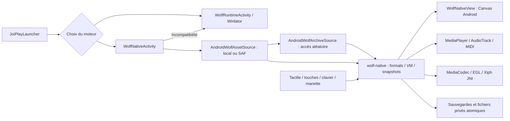

# Moteur Wolf Android intégré

Le moteur Kotlin exécute les événements et rend les cartes directement dans Android. Les archives sont lues à la demande dans le dossier choisi : aucune copie générale de ses dizaines de milliers de fichiers n'est nécessaire. Winlator reste disponible pour les fonctions ou protections non prises en charge. La [couverture](RUNTIME_COVERAGE.md) et la [validation de la bêta 15](../VALIDATION_1.12.0-beta.15.md) distinguent les contrats portés, les parcours réellement exécutés et les limites.

La [validation de la bêta 16](../VALIDATION_1.12.0-beta.16.md) couvre une correction du lecteur des bases : un type sans colonnes ne consomme aucun octet par ligne dans le DAT. Les noms restent lus dans le PROJECT ; le lecteur conserve les limites de ressources, le contrôle du nombre de définitions et celui du footer, indépendamment de la taille des types suivants.

## Choisir le moteur

**Outils → Réglages Wolf RPG → Moteur** conserve les trois choix par jeu :

- **Automatique** conserve le parcours Windows d'un jeu ayant déjà son préfixe ou son état Windows. Pour un nouveau jeu, il examine les métadonnées, cartes, pages, commandes et routes avant l'admission native. Un refus conserve son diagnostic et utilise Winlator.
- **Natif Android · expérimental** lance directement le moteur natif. Une fonction inconnue arrête la session avec carte, événement, commun, opcode et offset, puis propose **Lancer avec Winlator**.
- **Winlator / Windows** utilise le parcours Windows existant.

L'admission statique examine toutes les cartes pour un résultat positif. Elle peut s'arrêter plus tôt sur une incompatibilité définitive ; le rapport indique cette différence. Elle ne certifie pas la jouabilité de toutes les branches.

## Architecture

Le module `wolf-native` ne dépend pas d'Android. Une session possède sa VM, son RNG, ses variables, bases de données, pages, routes, caméra, images, entrées et effets. Un seul worker modifie cet état. Le tick logique suit la cadence du jeu ; le thread UI regroupe les frames. Une opération asynchrone reprend le tick suspendu, sans avancer artificiellement ses compteurs ni perdre les appuis reçus pendant l'attente. Le budget de 50 000 instructions par tick borne les boucles accidentelles.

Les lecteurs prennent en charge les enveloppes documentées de Game.dat, CommonEvent.dat, bases de données, tilesets et cartes CP932/UTF-8/LZ4. Les profils DX/Wolf et leurs chaînes de clés sont décrits dans [ARCHIVE_FORMATS.md](../../wolf-native/ARCHIVE_FORMATS.md). Les limites d'index, chemins, codecs, tailles et allocations sont vérifiées avant lecture ou expansion. Elles ne représentent pas une mesure exacte du pic de mémoire JVM.

## Ressources, rendu et médias

Le moteur consulte le dossier local ou le sous-dossier d'un arbre SAF choisi par l'utilisateur. Il n'indexe que les répertoires visités. Les archives utilisent les positions des entrées ; un fichier protégé ou une police WOLFX est décodé au moment où il est demandé. Les originaux restent inchangés. Les recherches insensibles à la casse refusent les ambiguïtés et les chemins qui sortent du jeu.

Le rendu comprend les couches de carte, autotiles, personnages, collisions, fenêtres Wolf, images, textes, choix, transitions, effets et masques documentés. Le cache de bitmaps et celui des morceaux de carte sont bornés ; les ressources visibles sont conservées. Les polices propres au jeu sont résolues hors du thread UI et capturées à la création du texte : un changement ultérieur ne réécrit pas les anciennes images de texte. Une ombre facultative absente est ignorée avec diagnostic, comme dans les moteurs de référence ; une image obligatoire absente reste une erreur.

Le filtre demandé par Sys140 s'applique à l'image finale, y compris textes et rectangles. Sys148 est une préférence de fenêtre pour le prochain lancement : Astra la conserve par jeu sans modifier Game.ini. Android garde son adaptation à l'écran et le mode d'image choisi par l'utilisateur.

L'audio utilise MediaPlayer pour les formats Android, un synthétiseur MIDI Android et AudioTrack pour le PCM Vorbis des vidéos. Les canaux, volumes maîtres, voix SE/BGS, fades, boucles, positions et changements de tonalité portés restent séparés. Le synthétiseur Android ne reproduit pas les timbres de GuruGuruSMF Windows.

Les vidéos MP4 passent par les décodeurs Android et SurfaceTexture/EGL ; les OGV Theora/Vorbis passent par les bibliothèques BSD Xiph épinglées dans `astra_wolfcodecs`. Les tests contrôlent les pixels et le PCM réellement décodés, ainsi que l'horloge AudioTrack. Une vidéo à une vitesse différente utilise la conversion PCM effective. Ces preuves ne certifient pas une écoute sur haut-parleur physique ou tous les profils vidéo.

## Fichiers, réseau et cycle de vie

Les commandes de fichiers lisent directement les originaux et écrivent dans un overlay privé par jeu. Les remplacements utilisent AtomicFile et gardent une version précédente. L'export comprend cet overlay et ses sauvegardes, sans recopier les ressources du jeu. L'encodage, le BOM, les fins de ligne et les règles CSV suivent les profils qualifiés ; un CSV facultatif absent préserve la base existante.

Les téléchargements260 sont bornés et annulables. Une restauration ou un retour au titre abandonne la requête ; une réponse tardive ne remplace pas les données de la nouvelle session. La saisie clavier et la synthèse vocale sont reliées aux services Android, avec diagnostic des ressources ou voix indisponibles.

Les commandes restent masquées pendant les étapes de préparation et apparaissent après une première image effectivement rendue dont les ressources obligatoires sont prêtes. Pause, perte de focus, menu et verrouillage suspendent les médias et relâchent les entrées. Une relance crée une session neuve. Les erreurs et attentes prolongées restent enregistrées dans les diagnostics.

## Contrôles et affichage

Les touches conservent taille, opacité, position par orientation et actions remappées. Deux doigts envoient Retour ; le pincement optionnel zoome de 1× à 4× et permet de déplacer l'image. **Image entière** agrandit sans rogner ni déformer ; **Remplir** conserve les proportions en rognant ; **Étirer** utilise tout l'espace en modifiant les proportions. La résolution logique et le décor restent ceux du jeu.

Les coordonnées tactiles sont converties dans le viewport logique. Le déplacement suit les collisions et déclencheurs portés. L'option Direction au toucher fournit des directions maintenues. Clavier, écran, manette et boutons sont agrégés pour qu'un relâchement ne libère pas une touche encore tenue par une autre source.

## Sauvegardes natives

Les fichiers se trouvent dans `files/wolf-native/<SHA-256 de l'identifiant du jeu>/saves/slot-N.astrawolf`. Les noms de sauvegarde demandés par le jeu utilisent des identités privées `named-<SHA-256>.astrawolf`, sans accéder à un chemin système. Le format `ASTRA-WOLF-NATIVE-1/2` enveloppe les données AWNS/AWNF avec empreinte des métadonnées, somme SHA-256 et CRC interne. Chaque remplacement est atomique et conserve une copie `.previous`.

L'état conserve variables et bases mutables, personnages et routes, effets, caméra, images et animations, audio, contrôles et modifications de carte. Le codec lit aussi les anciennes sauvegardes Astra, dont le format V2 publié dans beta14. Une restauration valide l'ensemble avant de modifier la session ; elle abandonne les anciennes opérations asynchrones. Les piles d'événements et le dialogue en cours ne sont pas repris, selon le contrat de chargement qualifié.

Les sauvegardes Wolf Windows restent distinctes. Aucune migration de `.sav` Windows vers AWNS n'est annoncée. Le menu propose sauvegarde, chargement et export natifs ; **Outils → Sauvegardes Wolf RPG** affiche séparément les données des deux moteurs.
